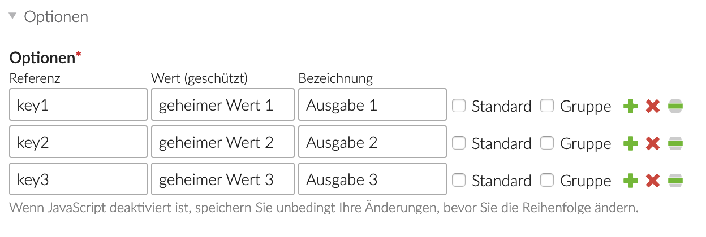
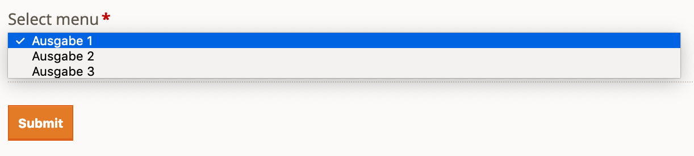

# protectedselect Contao extension

## [DE] Geschütztes Select-Menü

Stellt ein Select-Menu für Formulare bereit, deren Klartextwerte nicht im Frontendformular angegeben sind.

## [EN] Protected select menu

Adds a new form select widget which hides the internal field values in the front end.

## Insert tag

You can use the following InsertTag to get the reference, label, and protected value.

**Reference** {{protected_select::YOUR-FIELD-NAME::reference}}  
**Label** {{protected_select::YOUR-FIELD-NAME::label}}  
**Protected value:** {{protected_select::YOUR-FIELD-NAME}}

## Screenshot

**Backend form**

**Frontend form**

